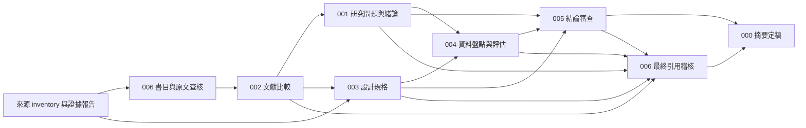

# ICEIB 全稿規格與執行順序

2026-11-25 · PLAN-002 v0.1 · 待研究者核准

## 全稿寫作要求

- 正文使用正式學術英文。規劃、詢問與進度說明使用繁體中文。
- 以 IEEEtran conference 雙欄撰稿，使用 Index Terms、標準章節層級、圖表編號與交叉引用，以及依首次出現排序的數字引文。ICEIB 2027 官網列出英文與全文 4–8 頁。該頁目前列 Engineering Proceedings DOCX，正式投稿以核准路線的已確認範本與要求為準。[ICEIB 投稿規則](https://www.iceib.asia/#submission) · [IEEE 官方模板](https://www.overleaf.com/latex/templates/ieee-conference-template/grfzhhncsfqn/)
- 全稿共用研究母體、地區、樣本定義、價格單位、工具上限、Agent 名詞及基準流程。撰稿後應以接近投稿的 LaTeX 環境編譯，檢查頁數、圖表可讀性、引文及版面。
- 每個擬發表的數值、研究現況、技術機制與文獻判斷保留主張 ID、來源 ID、定位（頁／節或版本）、查核日期與狀態。狀態採已驗證資料、提案方法、研究假設、計畫實驗、缺少證據、已完成且可重現的實驗結果。
- 主張缺少可靠來源時，標記研究限制、查找原文或縮小主張。無日誌及可重現結果的實驗寫為計畫。資料的可取得性、可分享性和可作為證據的範圍分開核對。
- 流程圖、架構圖與評估表應能追溯至原設計或結果。保留可編輯來源，審查圖中文字、符號、註解、引用及使用權。

## 目錄結構

| 路徑 | 用途 | 狀態 |
| --- | --- | --- |
| `myRef/` | 使用者提供的唯讀來源 | 現有，保持原位 |
| `openspec/config.yaml`、`openspec/changes/`、`openspec/specs/` | 設定、七項 active change、未來核准的 baseline specs | 現有，baseline 空 |
| `research/academic-plan/`、`research/cross-validation/` | 本次盤點與執行計畫、原文與實證查核 | 現有 |
| `research/originals/`、`research/notebooklm/`、`research/perplexity/` | 已歸檔來源及 AI 分析 | 現有，透過索引引用 |
| `research/refactor/` | 稿件及現有單檔 Overleaf 初稿 | 現有 |
| `research/refactor/figures/` | 論文可編輯圖源與輸出圖 | 有核准的圖才建立 |
| `research/experiments/` | 核准的規約、清單、分數、圖表及去識別／最小化的執行紀錄 | 有核准的規約或結果才建立 |
| `papers/` | 書目 inventory、日後的 BibTeX 與引文稽核 | 現有 |
| `submission/` | 核准的最終 LaTeX 專案、編譯 PDF 與投稿清單 | 定稿後建立 |

既有圖 `research/infographic/` 保留原始衍生素材角色。圖表、原始資料與最終版採引用或必要封裝，避免重複複製。計畫審查期間稿件留在原路徑。

## 章節依賴

箭頭表示研究內容或審查門檻。七個 OpenSpec 變更皆可獨立編輯、驗證和審查。

| 階段 | 工作 | 審閱條件 |
| --- | --- | --- |
| 1 | 核准計畫後啟動 006 原文查核及 002 比較矩陣，可同時檢視 003 的設計來源 | 確認研究範圍，避免把 MR-003 文獻線索視為驗證 |
| 2 | 收斂 001 研究問題，定稿 003 方法契約，確認 004 規約、資料與指標分母 | 研究問題與評估可互相對照。資料欄位、執行條件與授權明確 |
| 3 | 取得實驗執行核准後，依 004 產出重現紀錄。完成 004、005 以及 001 的貢獻說明 | 每項結果可追溯。未執行的部分使用規劃措辭，報告可用範圍 |
| 4 | 完成 006 引用稽核後，才定稿 000。摘要併入後再做一次全稿引文與編譯檢查 | 正文、結論、摘要一致。正式摘要若還缺實驗證據，提請研究者確認期程或提案定位 |

本次請審閱候選母體、固定／自適應比較的研究問題、是否規劃 ML 支線，以及七個章節的驗收門檻。提交狀態 PENDING，提交 SHA 不可取得。
